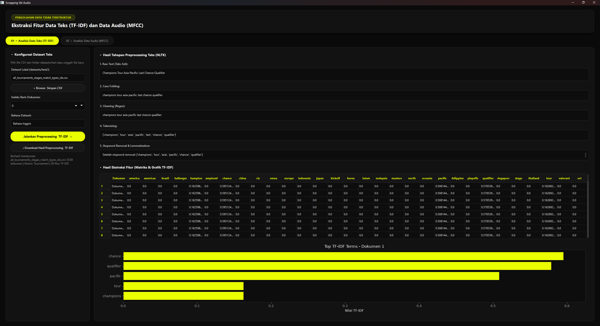
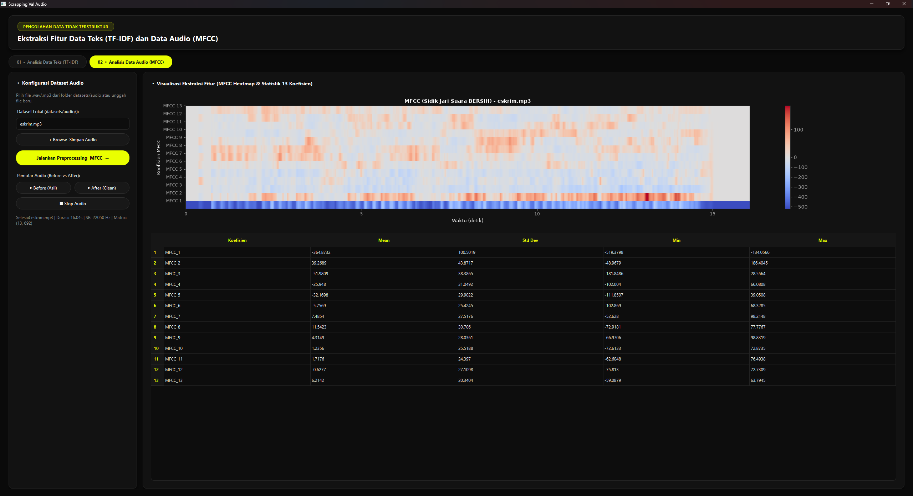

# Scrapping Val Audio — Ekstraksi Fitur Data Teks (TF-IDF) & Data Audio (MFCC)

Aplikasi desktop berbasis **Python** dan **PyQt6**. Aplikasi ini dirancang untuk mengeksplorasi tahapan *preprocessing* hingga ekstraksi fitur dan visualisasi pada dua jenis data tidak terstruktur: **Data Teks (`.csv`)** menggunakan metode **TF-IDF** dan **Data Audio (`.wav` / `.mp3`)** menggunakan metode **MFCC**.

---

## Tampilan Aplikasi

### 1. Analisis Data Teks (Preprocessing & TF-IDF)


### 2. Analisis Data Audio (Noise Reduction & MFCC Heatmap)



---

## Fitur Utama

### 01 ▪ Analisis Data Teks (TF-IDF)
* **Manajemen Dataset Otomatis:** Memilih dataset lokal dari `datasets/text/` atau mengunggah file `.csv` baru yang otomatis tersalin ke folder dataset lokal.
* **Dukungan Dua Bahasa:** Mendukung *preprocessing* untuk **Bahasa Inggris** (*NLTK WordNet Lemmatizer*) dan **Bahasa Indonesia** (*Sastrawi Stemmer*).
* **Inspeksi Tahapan Preprocessing:** Menampilkan perubahan teks secara transparan mulai dari *Raw Text*, *Case Folding*, *Cleaning (Regex)*, *Tokenizing*, hingga *Stopword Removal & Lemmatization/Stemming*.
* **Matriks & Grafik TF-IDF:** Menghitung bobot TF-IDF dokumen, menampilkan matriks dalam tabel interaktif, serta memvisualisasikan *Top TF-IDF Terms* dalam grafik batang.
* **Export Hasil ke CSV:** Menyimpan gabungan seluruh tahapan *preprocessing* dan skor matriks TF-IDF ke file `.csv` siap olah.

### 02 ▪ Analisis Data Audio (MFCC)
* **Manajemen Dataset Audio:** Memilih file `.wav` atau `.mp3` dari `datasets/audio/` atau menambahkan file audio baru dari komputer.
* **Audio Preprocessing (*Noise Reduction*):** Meredam derau latar (*background noise*) menggunakan algoritma *spectral gating* (`noisereduce`) sebelum ekstraksi fitur dilakukan.
* **Pemutar Perbandingan (*Before vs After*):** Memutar langsung perbandingan suara asli (**Before**) dengan suara bersih hasil pemrosesan (**After**).
* **Ekstraksi 13 Koefisien MFCC:** Menghasilkan visualisasi **MFCC Heatmap** berbasis waktu serta tabel statistik lengkap (*Mean*, *Std Dev*, *Min*, dan *Max*) untuk `MFCC_1` hingga `MFCC_13`.

---

## Library Python (`pip`) yang Digunakan

Seluruh library berikut diperlukan agar aplikasi dan modul pemrosesan teks maupun audio berjalan optimal:

| Library (`pip`) | Kegunaan dalam Proyek |
| :--- | :--- |
| **`PyQt6`** | Membangun antarmuka pengguna desktop (GUI), tabel, tab navigasi, dan pemutar audio (`QMediaPlayer`). |
| **`pandas`** | Membaca dataset `.csv`, menyusun tabel statistik MFCC, serta mengekspor hasil *preprocessing* dan matriks TF-IDF. |
| **`numpy`** | Operasi array numerik pada matriks audio, pemotongan sinyal (*clipping*), dan perhitungan statistik koefisien. |
| **`matplotlib`** | Merender grafik batang *Top TF-IDF Terms* dan kanvas visualisasi *MFCC Heatmap* langsung di dalam jendela aplikasi. |
| **`scikit-learn`** | Menghitung ekstraksi fitur teks menggunakan `TfidfVectorizer` dan daftar *stopword* bahasa Inggris. |
| **`librosa`** | Memuat file audio, menghitung durasi & *sample rate*, mengekstrak koefisien MFCC, dan menampilkan spektrogram. |
| **`soundfile`** | Menyimpan hasil audio yang telah dibersihkan (*After Clean*) ke format `.wav` (`PCM_16`) untuk diputar di aplikasi. |
| **`noisereduce`** | Melakukan *preprocessing* reduksi derau stasioner (*stationary noise reduction*) pada sinyal audio mentah. |
| **`nltk`** | Melakukan *lemmatization* (`WordNetLemmatizer`) pada tahap pembersihan kosakata bahasa Inggris. |
| **`PySastrawi`** | *(Opsional)* Melakukan *stemming* kata dasar bahasa Indonesia saat mode Bahasa Indonesia dipilih. |

---

## Struktur Proyek

```text
tfidf-mfcc-analyzer/
├── app.py                  # Entry point utama aplikasi desktop PyQt6
├── assets/
│   ├── style.qss           # Stylesheet tema gelap (Dark Studio Edition)
├── modules/
│   ├── text_tfidf.py       # Modul preprocessing teks & ekstraksi fitur TF-IDF
│   └── audio_mfcc.py       # Modul noise reduction & ekstraksi fitur MFCC
├── datasets/
│   ├── text/               # Penyimpanan dataset teks (.csv)
│   └── audio/              # Penyimpanan dataset audio (.wav / .mp3)
└── README.md               # Dokumentasi proyek
```

---

## Cara Instalasi & Menjalankan Aplikasi

1. **Clone atau unduh repositori ini**, lalu buka terminal di dalam folder proyek:
   ```bash
   cd tfidf-mfcc-analyzer
   ```

2. **(Opsional) Buat dan aktifkan virtual environment:**
   ```bash
   python -m venv venv
   # Windows:
   venv\Scripts\activate
   # macOS / Linux:
   source venv/bin/activate
   ```

3. **Instal seluruh library yang dibutuhkan via `pip`:**
   ```bash
   pip install PyQt6 pandas numpy matplotlib scikit-learn librosa soundfile noisereduce nltk PySastrawi
   ```

4. *(Opsional)* Unduh corpus WordNet NLTK untuk lemmatization bahasa Inggris:
   ```bash
   python -c "import nltk; nltk.download('wordnet')"
   ```

5. **Jalankan aplikasi desktop:**
   ```bash
   python app.py
   ```

## Contributor
```text
Nama    : I Putu Angga Widhyadana Putra (240030309)
Username: KillyNourin

Nama    : I Gede Wiryaartha Adi Karsa (240030239)
Username: DragonEmperor5

Nama    : Putu Dharma Putra (240030310)
Username: OrisKunzz

Nama    : I Putu Kenny Juaguns Naru (240030320)
Username: Rinshiryu

Nama    : I Kadek Gede Riyan Manik Utama Putra (240030282)
Username: kadekg783-commits
```

<a href="https://github.com/KillyNourin">
  
</a>

<a href="https://github.com/DragonEmperor5">
  
</a>

<a href="https://github.com/OrisKunzz">
  
</a>

<a href="https://github.com/Rinshiryu">
  
</a>

<a href="https://github.com/kadekg783-commits">
  
</a>